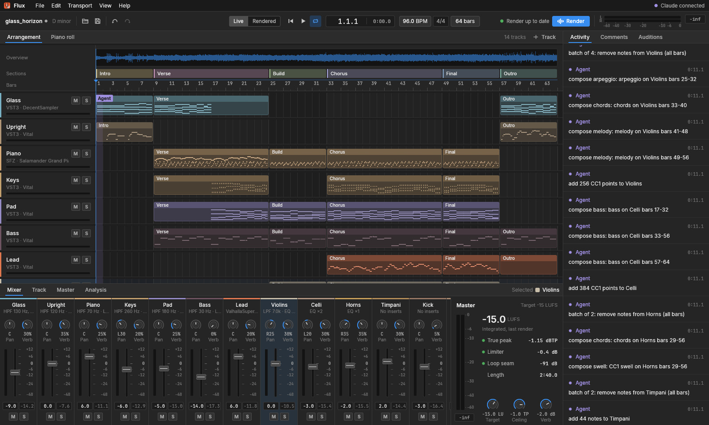
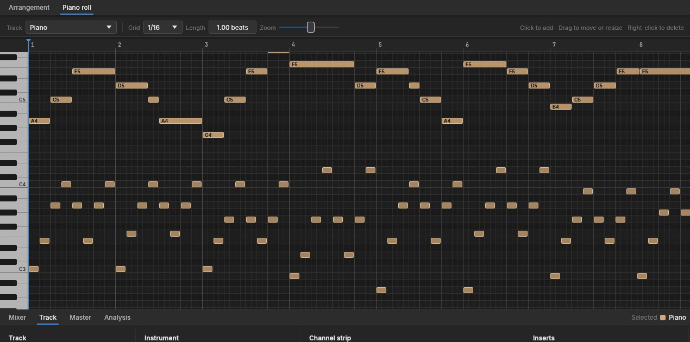
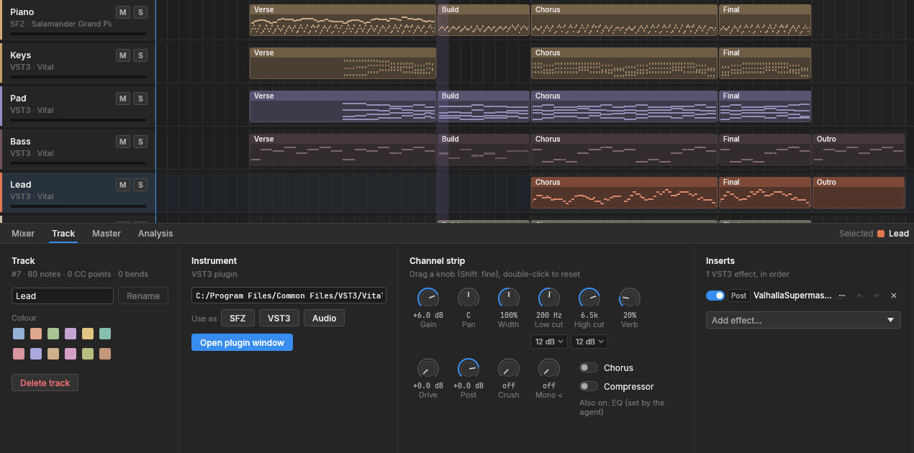
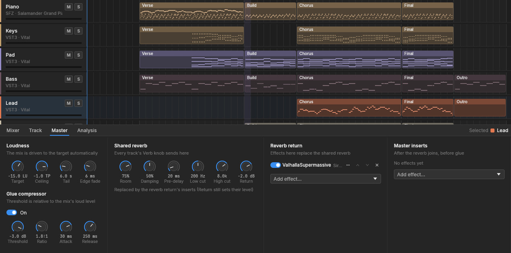
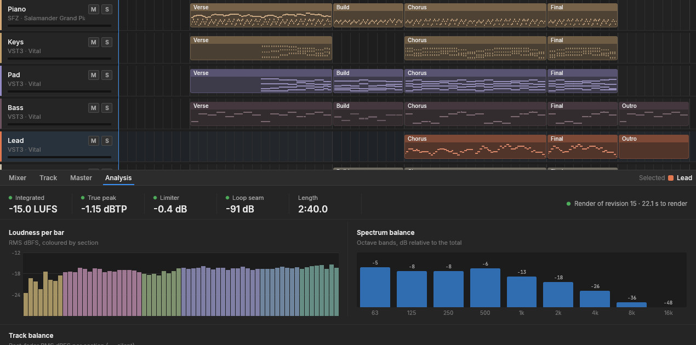

<p align="center">
  
</p>

<h1 align="center">Flux</h1>

<p align="center">
  <b>An agent-first DAW, written in Rust, for original game music that loops without a seam.</b><br>
  Compose, arrange, play sampled instruments and VST3 plugins, mix and master,<br>
  with an AI agent and a human working in the same session. Sampled instruments and other people's presets, never AI audio.
</p>

<p align="center">
  
  
  
  
  
  <a href="#license-and-credits"></a>
</p>

<p align="center">
  <a href="#features">Features</a> ·
  <a href="#everything-in-the-box">Everything in the box</a> ·
  <a href="#built-for-agents">Agents</a> ·
  <a href="#under-the-hood">Under the hood</a> ·
  <a href="#get-started">Get started</a> ·
  <a href="#in-a-roblox-game">Roblox</a> ·
  <a href="#license-and-credits">Credits</a>
</p>

<br>

<p align="center">
  
  <br>
  <sub>A song in progress in Flux: Vital, Decent Sampler, a sampled orchestra and drums on fourteen tracks.<br>
  The agent's edits scroll by in Activity as it works.</sub>
</p>

> [!NOTE]
> **Every sound comes from a real instrument or someone else's preset.** Flux plays sample libraries, and plugins through their makers' presets. No sounds are designed from scratch, and no AI audio models are used. Every library that can end up in a song allows commercial use, and [LICENSES.md](LICENSES.md) lists each one with its official source and license.

<br>

<table>
  <tr>
    <td width="25%" valign="top">
      <h3>🤖 Agent-first</h3>
      Every change is a command. An agent over MCP and a human in the window get the same powers, the same undo history and the same project, live.
    </td>
    <td width="25%" valign="top">
      <h3>🎻 Samples and plugins</h3>
      SFZ libraries through sfizz, VST3 plugins in their own processes (a plugin crash can't take Flux down), and guitar rigs built on Neural Amp Modeler captures.
    </td>
    <td width="25%" valign="top">
      <h3>🎚️ Mixed and mastered</h3>
      A channel strip on every track, VST3 inserts, sidechain ducking, a glue compressor, and a master that drives the mix to its loudness target under a true-peak ceiling.
    </td>
    <td width="25%" valign="top">
      <h3>🔁 Loops without a seam</h3>
      Songs render in steady state: tails fold onto bar 1 and every effect runs as if the loop had always been playing. Every render measures the seam.
    </td>
  </tr>
</table>

<br>

## Features

Every screenshot here is the real app, captured through Flux's own `gui` tool.

<table>
  <tr>
    <td width="50%" valign="top">
      
      <br>
      <sub>A sketch in the piano roll: a melody over left-hand arpeggios, both written by <code>compose</code>.</sub>
      <h3>Write it, or have it written</h3>
      Click to add notes, drag to move or resize them, or play them in from a MIDI keyboard (or the computer keyboard) and record takes while the song loops. Or let the agent write: <code>compose</code> turns a short notation such as <code>"E4:2 G4:1 B4:1 | A4:3 r:1"</code> into a phrased melody, voices chords from the chord track with real voice leading, and writes bass lines, arpeggios, CC swells and pitch-bend curves, each as one undoable edit.
      <br><br>
      Before anything is rendered, <code>lint</code> reads the score for what a listener would hear as a mistake: clashes, non-chord tones on strong beats, notes outside an instrument's range, mud, parallel fifths and octaves.
    </td>
    <td width="50%" valign="top">
      
      <br>
      <sub>The lead's channel strip: a Vital preset playing into Valhalla Supermassive.</sub>
      <h3>A channel strip on every track</h3>
      Gain, pan and width; low and high cuts at 12 to 48 dB per octave; EQ bands; drive, amp, bitcrush and clip; a gate, a compressor, chorus and delay; mono below a frequency; a sidechain duck keyed from any track; a send to the shared reverb.
      <br><br>
      Any VST3 effect goes before or after the strip. Plugin sounds load from the makers' own preset files, headless: Vital banks, Decent Sampler libraries, Valhalla presets.
    </td>
  </tr>
  <tr>
    <td width="50%" valign="top">
      
      <br>
      <sub>The master: a loudness target, a glue compressor, and Supermassive in place of the shared reverb.</sub>
      <h3>Mastered to a number</h3>
      Set a loudness target and a true-peak ceiling, and every render drives the mix to them (−15 LUFS and −1 dBTP for the game's songs). There's a glue compressor with a threshold relative to the mix, master EQ, a shared reverb whose return can be swapped for plugins, and master inserts.
      <br><br>
      Exports are 16-bit dithered FLAC from a pure-Rust encoder, with per-track stems and layers that sum back to the master.
    </td>
    <td width="50%" valign="top">
      
      <br>
      <sub>Every render is measured: loudness, true peak, limiting, the loop seam, loudness per bar and spectral balance.</sub>
      <h3>Measure what you can't hear</h3>
      An agent can't listen, so Flux measures for it. <code>mix_check</code> finds masking, mud, harshness, smearing and mono problems and names the tracks causing them. <code>reference_match</code> compares the mix with a reference track at equal loudness, <code>spectrogram</code> shows where the energy is over time, and <code>game_audio_check</code> checks a game's whole soundtrack as a set.
      <br><br>
      Instruments get report cards measured from their samples: playable range, tuning per key in cents, level and brightness. The agent picks instruments that are actually in tune.
    </td>
  </tr>
</table>

<br>

## Everything in the box

<table>
  <tr>
    <td width="33%" valign="top">
      <h4>🧰 28 MCP tools</h4>
      get_project · edit · undo · redo · compose · lint · get_notes · new_project · open · save · render · analyze · export · mix_check · reference_match · spectrogram · game_audio_check · instrument_card · probe_instrument · list_instruments · sfz_derive · sfz_sets · plugins · transport · gui · activity · comments · audition
    </td>
    <td width="33%" valign="top">
      <h4>✏️ 31 edit commands</h4>
      Project, tempo, sections and the chord track · add, update and remove tracks · mixer and master settings · add, update, move and remove inserts · add, remove and delete notes · quantize · humanize · transpose · scale velocity · CC and pitch bend · automation · add, update, split and remove audio clips · copy and clear bars. A batch of them is atomic and undoes as one step.
    </td>
    <td width="33%" valign="top">
      <h4>🔍 12 score checks</h4>
      Clashes · non-chord tones on strong beats · instrument ranges · low-register mud · parallel fifths and octaves · voice crossing · awkward leaps · overlapping notes · controller problems · notes past the end · keyswitches · unreadable chord symbols.
    </td>
  </tr>
  <tr>
    <td width="33%" valign="top">
      <h4>🎻 Instruments</h4>
      SFZ through sfizz 1.2.3 · VST3 instruments and effects · guitar and bass rigs (NAM captures and cabinet IRs) · audio clips anywhere on the timeline (WAV, FLAC or OGG at any sample rate). SFZ tools make fixed copies of an instrument without touching the original: retune each sample, even out levels, shorten releases so gaps stay silent. Wrapper sets add CC dynamics and keyswitch articulations.
    </td>
    <td width="33%" valign="top">
      <h4>📦 Assets you can ship</h4>
      One manifest (<code>assets.toml</code>) with a license policy. <code>flux assets fetch</code> downloads only from official sources, pins checksums and refuses anything else. Then <code>verify</code> and <code>repair</code> the installs, audit the licenses, and generate <a href="LICENSES.md">LICENSES.md</a> and the in-game credits.
    </td>
    <td width="33%" valign="top">
      <h4>🖥️ The app</h4>
      Arrangement with sections, a waveform overview, audio clips and automation lanes · piano roll · mixer · MIDI keyboard and computer-keyboard input, monitored and recorded · Track, Master and Analysis tabs · Activity, Comments (notes pinned to bars) and Auditions (A/B tests the agent sets up for you) · live playback or the last render · a compact dark theme.
    </td>
  </tr>
</table>

<br>

## Built for agents

Flux runs as an MCP server on stdio. The [`.mcp.json`](.mcp.json) in this repo registers it with Claude Code, and `--gui` opens the window too, so you can watch the agent work and edit alongside it:

```json
{ "mcpServers": { "flux": { "command": "daw/target/debug/flux.exe", "args": ["mcp", "--gui"] } } }
```

Everything is a tool call. A batch of edits is atomic and undoes as one step:

```jsonc
// edit: a Vital track, its channel strip, and a duck keyed from the kick
{"commands": [
  {"op": "add_track", "name": "Bass",
   "instrument": {"kind": "vst3", "path": "C:/Program Files/Common Files/VST3/Vital.vst3"}},
  {"op": "set_mixer", "track": "Bass", "mixer": {"hpf_hz": 30, "lpf_hz": 2500,
                                                "duck": {"source_track": "Kick", "depth_db": 5, "release_ms": 140}}}
]}

// compose: a phrased melody from notation (units of an eighth note)
{"action": "melody", "track": "Lead", "bar": 9, "unit": 0.5, "phrase": true,
 "notation": "A4:2 C5:2 E5:4 | D5:3 C5:1 B4:2 G4:2 | A4:6 r:2 | E5:2 D5:2 C5:2 B4:2"}
```

The same engine runs headless from the command line:

```powershell
flux render song.flux.json song.wav --stems stems\ --report report.json
flux assets fetch --all             # instruments and tools, from official sources only
flux sfz retune SOURCE.sfz ...      # a retuned copy (the original is never touched)
```

Whole songs can be scripts too: a Python build script pushes a song into a running session step by step (tracks, presets, chord track, parts, mix) through [`daw/bridge/live.py`](daw/bridge/live.py), so you can watch it being built and re-run any step.

## Under the hood

- **One command system:** a pure-data project model and the commands that change it live in `flux-core`. The GUI and the MCP server are thin layers on top, so a human and an agent can't drift apart.
- **Plugins out of process:** each VST3 plugin runs in a `flux plugin-host` child process. Flux gives plugins the song's tempo and position, so synced LFOs, arpeggiators and delays follow along.
- **Offline and live:** the offline renderer runs every effect over the end of the loop, the loop itself and its start, which makes the wrap identical to continuous playback. The live engine plays through cpal with the same channel-strip DSP.
- **Nine crates:** `flux` (app, MCP server, CLI) · `flux-core` (model, commands) · `flux-engine` (instruments, DSP, rendering) · `flux-vst3` (plugin hosting) · `flux-nam` (amp-capture inference, cabinets) · `flux-score` (theory, compose, lint) · `flux-analysis` (measurements) · `flux-sfz` (SFZ parsing and tools) · `flux-assets` (manifest, fetcher, licenses, FLAC).
- **Tested:** about 480 Rust tests, including pixel snapshots of the GUI (egui_kittest) and click-through tests of its panels.

## Get started

You need Windows (tested on Windows 11) and a recent Rust toolchain (edition 2024).

```
git clone https://github.com/karmawastakenalready/Flux-DAW
cd Flux-DAW
cargo build --manifest-path daw\Cargo.toml          # builds daw\target\debug\flux.exe
daw\target\debug\flux.exe assets fetch --all        # sfizz and the sample libraries, from official sources
daw\target\debug\flux.exe                           # the window, with a new project
```

A few assets have no direct download link (the guitar library and the amp captures). `flux assets status` lists what's missing, and [LICENSES.md](LICENSES.md) links each one's official page. The VST3 plugins Flux is built around are free downloads from their makers: [Vital](https://vital.audio), [Decent Sampler](https://www.decentsamples.com/product/decent-sampler-plugin/) and [Valhalla Supermassive](https://valhalladsp.com/shop/reverb/valhalla-supermassive/). Install them to `C:\Program Files\Common Files\VST3`; `flux assets status` shows which ones it finds.

To work with an agent, open this folder in Claude Code. It picks up `.mcp.json` and opens the Flux window when the agent connects.

> [!IMPORTANT]
> **Status:** Flux is in early alpha and built around one composer's workflow: game music for a Roblox game. It runs on Windows only, because the VST3 host is Win32. Some parts are rough, and the original Python pipeline that made the first songs (`compose.py`, `render.py` and friends at the root) is retired but still here.

## In a Roblox game

Flux was made for a Roblox game's soundtrack. Its songs are mastered to −15 LUFS with true peaks at or under −1 dBTP and exported as 16-bit FLAC, under Roblox's 20 MB limit.

Upload the FLAC (not MP3: encoder padding adds a gap at the loop point) and set `Sound.Looped = true`. Each export starts with the tail of its last bar folded onto bar 1, so it loops without a click. `game_audio_check` checks all of a game's songs together before they ship.

## Repository layout

| Path | What's there |
|---|---|
| [`daw/`](daw/) | Flux: the Rust workspace (`crates/`) and the live-session bridge (`bridge/`) |
| [`sfz/`](sfz/), [`catalog/`](catalog/) | our own SFZ mappings and fixed instrument copies; instrument report cards |
| [`assets.toml`](assets.toml), [`assets.lock`](assets.lock) | every instrument, tool and plugin: official source, pinned checksums, license |
| [`docs/images/`](docs/images/) | the screenshots in this README |
| `compose.py`, `render.py`, `master.py`, … | the original Python pipeline (retired) |

Not in the repo: the songs, the sample libraries (fetched with `flux assets fetch`), the plugins (installed by you), saved plugin states (they hold vendors' preset data) and reference tracks.

---

## License and credits

**Flux** is free and open source: anyone can use it, change it and share it, commercially too. Its code, tools and SFZ mappings are licensed under either of

- [Apache License, Version 2.0](LICENSE-APACHE)
- [MIT license](LICENSE-MIT)

at your option. Unless you explicitly state otherwise, any contribution intentionally submitted for inclusion in Flux by you, as defined in the Apache-2.0 license, shall be dual licensed as above, without any additional terms or conditions.

**Not covered by that license:**
- **Songs** made with Flux are all rights reserved, and none are in this repository.
- **The Flux logo** (`daw/crates/flux/assets/icons/`). All rights reserved.
- **The UI fonts** (Inter and JetBrains Mono, in `daw/crates/flux/assets/fonts/`) are under the SIL Open Font License, with their license files next to them.
- **Third-party terms** in `licenses/terms/` belong to their authors.

**Sound libraries:** [LICENSES.md](LICENSES.md) lists every sample library, amp capture and tool Flux fetches, with its official source and license, and the credits to show in the game. It's generated by `flux assets licenses --no-usage` from [`assets.toml`](assets.toml). Only Salamander Grand Piano (CC BY 3.0) *requires* a credit; the others are credited anyway. The VST3 plugins are installed by you, under their makers' own terms; LICENSES.md summarizes those too, and `flux assets status` shows which plugins and libraries each project uses, including libraries a plugin loads from a saved preset.

<sub>VST is a registered trademark of Steinberg Media Technologies GmbH. Vital, Decent Sampler, Valhalla Supermassive and Neural Amp Modeler belong to their makers. Flux is an independent project and isn't affiliated with any of them.</sub>

<p align="center">
  <br>
  <sub>Made with Flux and Claude Code.</sub>
</p>
